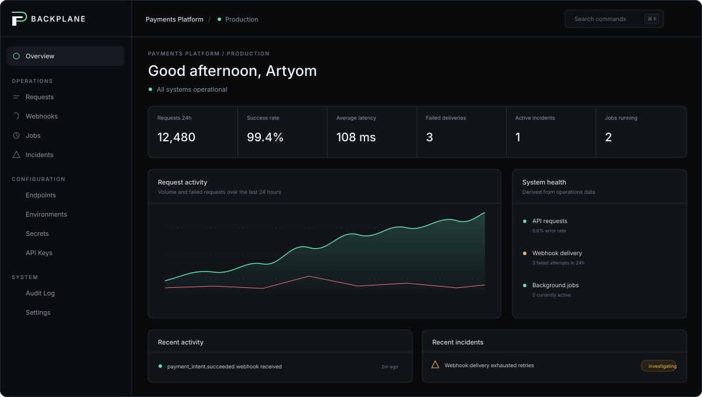
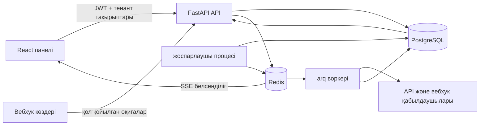

<div align="center">

# BACKPLANE

**API, вебхук және фондық тапсырмалар бойынша не құлағанын, не қайталанғанын және не өзгергенін көретін бір орын.**

[English](README.md) · [Русский](README.ru.md) · [Қазақша](README.kk.md)


</div>

<p align="center">
  
</p>

## Бұл не

Интеграциялардағы ақаулар әдетте қолданба логтарына, кезек панельдеріне, вебхук жеткізушілерінің беттеріне, cron орналасқан серверлерге және жеке нұсқаулықтарға шашырап кетеді. BACKPLANE бұл жолды әзірлеу командалары үшін бір басқару панеліне жинайды: API шақыру, вебхуктерді қабылдау және жіберу, фондық және жоспарлы тапсырмаларды іске қосу және бірдеңе қайта-қайта құлағанда инцидент алу.

Ол толық бақылау стегін алмастыруға тырыспайды. Ол үш сұраққа тез жауап беру керек сәтке арналған: не құлады, не қайталанды және не өзгерді.

| Аймақ | Не аласыз |
|---|---|
| **API** | Шығыс эндпоинттер тізілімі және жауаптар тарихы сақталатын сұраныс консолі |
| **Вебхуктер** | HMAC тексерісі, қайталаулар, қайта ойнату және жеткізілмегендер кезегі бар ашық қабылдау |
| **Тапсырмалар** | Redis негізіндегі фондық тапсырмалар және уақыт белдеуін ескеретін cron жоспарлаушы |
| **Инциденттер** | Қайталанатын 5xx, таусылған жеткізулер және құлаған тапсырмалар кезінде өздігінен ашылады |
| **Қолжетімділік** | Ұйымдар, жобалар, ортасы, төрт рөл, аймақтары бар API кілттері |
| **Із** | Аудит журналы, тірі белсенділік лентасы, Prometheus метрикалары, денсаулық тексерулері |

## Архитектура



Бэкенд модульдік монолит. Әр домендік модуль өз модельдеріне, схемаларына, роутерлеріне және бизнес-логикасына ие. Қауіпсіздік, қателер, беттеу, шифрлау, логтау және шығыс желі саясаты бірнеше шағын ортақ модульде орналасқан. Воркер мен жоспарлаушы HTTP сұраныстарымен бірдей домендік сервистерді және база ережелерін қолданады.

## Мүмкіндіктер

| Топ | Мәліметтер |
|---|---|
| **Тенанттар және рөлдер** | Ұйымдар, жобалар, ортасы. owner, admin, developer, viewer рөлдері бэкендте тексеріледі |
| **Аутентификация** | JWT, refresh-токендерді айналдыру, scrypt құпиясөз хэштеу, аймақтары бар API кілттері хэш түрінде сақталады |
| **Құпиялар** | Шифрланған қойма, шифрланған эндпоинт тіркелгі деректері, жасалғаннан кейін қайтарылмайды |
| **API консолі** | Эндпоинттер тізілімі, екі панельді сұраныс консолі, сақталған жауаптар тарихы |
| **Вебхук қабылдау** | Өлшем шегі, жиілікті шектеу, HMAC тексерісі, оқиғаларды қарау |
| **Жеткізу** | 1 / 5 / 15 минут үзілісімен жіберу, әрекеттер журналы, қайта ойнату, жеткізілмегендер кезегі |
| **Тапсырмалар** | Redis кезегі, PostgreSQL жолдарын құлыптайтын cron жоспарлаушы, қайталаулар |
| **Инциденттер** | Автоматты түрде анықталады, өмірлік циклі және хронологиясы бар |
| **Бақылау** | Құрылымдық логтар, сұраныс ID-лері, Prometheus метрикалары, SSE, нақты деректерден телеметрия |
| **Пайдалану** | Alembic миграциялары, демо деректер, Docker Compose, CI |

## Интерфейс

Интерфейс ең алдымен жұмыс үстеліне арналған, әр аймаққа бет бар: шолу, сұраныс консолі, вебхук инспекторы, тапсырмалар мен кестелер, инциденттер хронологиясы, эндпоинттер тізілімі, орталар, құпиялар қоймасы, API кілттері, аудит жазбалары және ұйым мүшелері. Ол мобильді навигацияға дейін бейімделеді және фокусты, жүктеу күйлерін, бос күйлерді, қателерді және растауларды сақтайды. `Ctrl+K` немесе `Cmd+K` кез келген жерде команда палитрасын ашады.

## Жылдам бастау

Docker Compose v2 және `make` қажет, немесе баламалы Compose командалары.

```bash
cp .env.example .env
make dev
```

Басқа терминалда демо деректерді жүктеңіз:

```bash
make seed
```

[http://localhost:8080](http://localhost:8080) мекенжайын ашып, демо тіркелгімен кіріңіз:

```text
demo@backplane.dev
backplane-demo
```

Әзірлеу режимінде API құжаттамасы: [http://localhost:8000/docs](http://localhost:8000/docs). `make dev` PostgreSQL, Redis, миграция тапсырмасын, API, воркерді, жоспарлаушыны және веб-интерфейсті іске қосады.

## Осы нұсқада жаңалары

| Не | Қазір қалай жұмыс істейді |
|---|---|
| Кезек | Тапсырма өз жолын жасаған транзакция коммит болғаннан кейін ғана кезекке түседі, сондықтан воркер бос жолды таппайды |
| Тапсырма күйлері | Ерекшелік тудырған тапсырма әрдайым соңғы күйде аяқталады және `RUNNING` күйінде қатып қалмайды |
| Қайталаулар | Тек `FAILED` күйіндегі тапсырманы қайталауға болады. Кез келген басқа күй `409` қайтарады |
| Жоспарлаушы | Әр жіберуден кейін Redis қосылымдар пулын босатады |
| Тесттер | 17 тест, оның 8-і кезек пен тапсырма күйлері туралы |

## Орта айнымалылары

| Айнымалы | Мақсаты | Әдепкі мән |
|---|---|---|
| `DATABASE_URL` | SQLAlchemy үшін асинхронды PostgreSQL DSN | Compose ішіндегі PostgreSQL |
| `REDIS_URL` | Кезек, жиілік шегі және белсенділік үшін Redis DSN | Compose ішіндегі Redis |
| `JWT_SECRET` | JWT қол қою құпиясы, кемінде 32 таңба | орналастырар алдында ауыстырыңыз |
| `ENCRYPTION_KEY` | Fernet кілтін шығаратын жеке құпиясөз | орналастырар алдында ауыстырыңыз |
| `CORS_ORIGINS` | Браузердің рұқсат етілген көздерінің JSON тізімі | жергілікті интерфейс мекенжайлары |
| `TRUSTED_HOSTS` | Хост middleware қабылдайтын JSON тізімі | жергілікті сервис атаулары |
| `PUBLIC_API_URL` | Кіріс вебхуктері үшін негізгі мекенжай | `http://localhost:8000` |
| `MAX_WEBHOOK_BYTES` | Вебхук денесінің ең үлкен өлшемі | 1 MiB |
| `WEBHOOK_RATE_LIMIT` | Көз бен эндпоинтке минутына оқиға саны | 120 |
| `ALLOW_PRIVATE_NETWORKS` | Жеке және резервтелген IP-ге шығыс сұраныстарға рұқсат | `false` |

Толық тізім [.env.example](.env.example) файлында. Жергілікті әзірлеуден тыс `JWT_SECRET` және `ENCRYPTION_KEY` тәуелсіз кездейсоқ мәндер болуы керек.

## API

Авторизацияланған маршруттар `/api/v1` астында:

```text
/auth                 тіркелу, кіру, refresh айналдыру, шығу, ағымдағы пайдаланушы
/organizations        ұйым баптаулары және мүшелер
/projects             тенант аясындағы жобалар
/environments         орталар және құпия емес айнымалылар
/endpoints            шығыс API сипаттамалары
/requests             сұраныстарды орындау және беттелген тарих
/webhooks             эндпоинттер, қабылдаушылар, кіріс, қайта ойнату, қайталау
/jobs                 тапсырма іске қосулары және қайталаулар
/scheduled-jobs       уақыт белдеуі бар cron кестелері
/incidents            анықтау, өмірлік цикл, хронология
/secrets              жасау, ауыстыру, метадеректер тізімі, жою
/api-keys             кілт бір рет көрсетіледі, аймақтар, қолдану, кері қайтару
/audit                беттелген әрекеттер журналы
/activity             соңғы белсенділік және SSE ағыны
/telemetry/dashboard  дерекқордан алынған шолу метрикалары
```

Сұраныстар `X-Organization-ID`, `X-Project-ID` және қажет болса `X-Environment-ID` тасымалдайды. Әр идентификатор аутентификацияланған субъектімен салыстырылады. API кілті өз аймақтары қамтитын сұраныс, вебхук және тапсырма маршруттарын ғана шақыра алады.

## Қауіпсіздік

| Шара | Қалай |
|---|---|
| Құпиясөздер | Әр құпиясөзге кездейсоқ тұзы бар scrypt |
| Refresh-токендер | Бір реттік: сәтті жаңарту ескі токенді кері қайтарып, ауыстырады |
| Құпиялар | Сақтау алдында шифрланады және жасалғаннан кейін қайтарылмайды |
| API кілттері | Тек SHA-256 хэштері ретінде сақталады, кілттің өзі бір рет көрсетіледі |
| Шығыс сұраныстар | Тек HTTP(S), мекенжайда тіркелгі деректері жоқ, редиректер жоқ, жеке, loopback, link-local, multicast және резервтелген мекенжайлар әдепкіде бұғатталған |
| Вебхуктер | Бапталатын өлшем шегі және Redis негізіндегі жиілік шектеуі |
| Қателер | Біркелкі жауап пішімі, стек трассасыз |

Бұл практикалық негіз, сертификаттау емес. Ашық орналастыру үшін TLS, басқарылатын құпиялар қоймасын немесе KMS, шекте жиілікті шектеуді, сақтық көшірме және қалпына келтіру рәсімдерін және орта үшін шығыс трафик саясатын қосыңыз.

## Тесттер және сапа

```bash
make test
make lint
make build
docker compose config --quiet
```

Тесттер аутентификацияны және refresh қайта қолданылуын, жобалар арасындағы тенант оқшаулауын, рөл тексерулерін, вебхук қолтаңбаларын және жеткізілмегендер бойынша инциденттерді, тапсырма қайталаулары мен күйлерін, коммиттен кейін кезекке жариялауды, API кілттерін хэштеуді және қайталанатын 5xx бойынша инцидентті анықтауды қамтиды. CI Python және TypeScript құрастыруларын бөлек тексереді.

## Жоба құрылымы

```text
backplane/
├── backend/
│   ├── alembic/                 схема миграциялары
│   ├── app/
│   │   ├── api/                 тәуелділіктер және маршруттау
│   │   ├── auth/ organizations/ projects/ environments/
│   │   ├── endpoints/ requests/ webhooks/ jobs/ incidents/
│   │   ├── secrets/ api_keys/ audit/ telemetry/
│   │   ├── core/ db/ workers/
│   │   └── main.py
│   └── tests/
├── frontend/
│   └── src/
│       ├── components/          қаңқа, команда палитрасы, интерфейс элементтері
│       ├── pages/               өнім беттері
│       ├── providers/           авторизация және жұмыс кеңістігі күйі
│       └── lib/                 API клиенті және пішімдеу
├── .github/workflows/ci.yml
├── docker-compose.yml
└── Makefile
```

## Жоспарлар

- Сақтау саясаттары және экспорт
- Инциденттерге бапталатын шектер
- OpenTelemetry трассаларымен байланыс
- SSO және SAML, ұйымға шақыруларды жеткізу
- Конверттік шифрлау үшін қосылатын KMS провайдерлері
- Қабылдаушы деңгейінде параллелизм шектері және сақтандырғыштар

---

<div align="center">

Авторы: **[Koncha Artyom](https://github.com/artyom129)** · MIT лицензиясы

</div>
