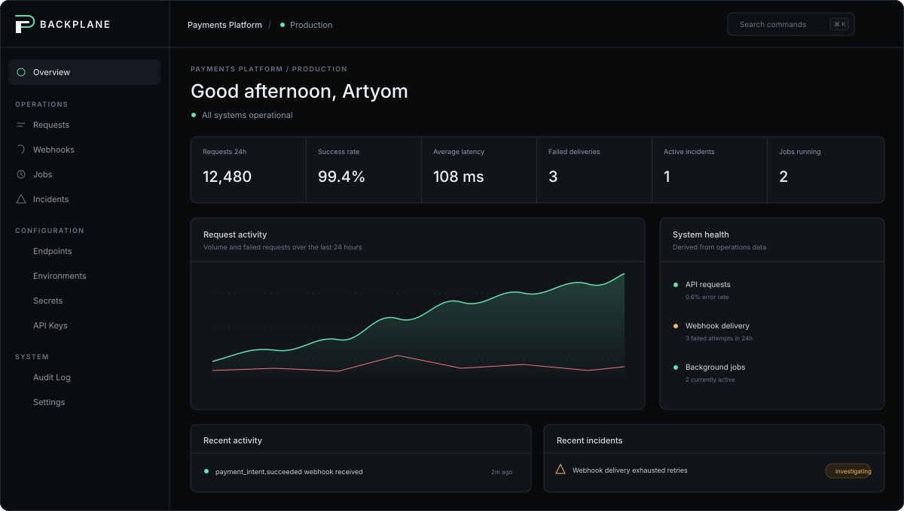
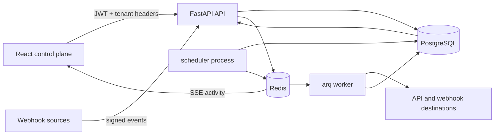

<div align="center">

# BACKPLANE

**One place to see what failed, what was retried, and what changed across your APIs, webhooks and background jobs.**

[English](README.md) · [Русский](README.ru.md) · [Қазақша](README.kk.md)


</div>

<p align="center">
  
</p>

## What it is

Integration failures are usually spread across application logs, queue dashboards, webhook vendor pages, cron hosts and private runbooks. BACKPLANE brings that path into one control plane for engineering teams: call APIs, receive and forward webhooks, run background and scheduled jobs, and get an incident when something keeps failing.

It does not try to replace a full observability stack. It is built for the moment someone has to answer three questions fast: what failed, what was retried, and what changed.

| Area | What you get |
|---|---|
| **APIs** | A registry of outbound endpoints and a request console with saved response history |
| **Webhooks** | A public inbox with HMAC verification, retries, replay and a dead-letter queue |
| **Jobs** | Redis-backed background jobs and a timezone-aware cron scheduler |
| **Incidents** | Opened automatically from repeated 5xx responses, exhausted deliveries and failed jobs |
| **Access** | Organizations, projects, environments, four roles, scoped API keys |
| **Trail** | Audit log, live activity feed, Prometheus metrics, health probes |

## Architecture



The backend is a modular monolith. Each domain module owns its models, schemas, routers and business logic. Security, errors, pagination, encryption, logging and outbound-network policy live in a few small shared modules. The worker and the scheduler use the same domain services and database rules as HTTP requests.

## Features

| Group | Details |
|---|---|
| **Tenancy and roles** | Organizations, projects, environments. Owner, admin, developer and viewer roles enforced on the backend |
| **Authentication** | JWT access tokens, refresh-token rotation, scrypt password hashing, scoped API keys stored as hashes |
| **Secrets** | Encrypted vault, encrypted endpoint credentials, never returned after creation |
| **API console** | Endpoint registry, two-pane request console, persisted response history |
| **Webhook inbox** | Payload limits, rate limiting, HMAC verification, event inspection |
| **Delivery** | Forwarding with 1 / 5 / 15 minute backoff, attempt log, replay, dead-letter handling |
| **Jobs** | Redis queue, cron scheduler with PostgreSQL row locking, retries |
| **Incidents** | Detected automatically, with a lifecycle and a timeline |
| **Observability** | Structured logs, request IDs, Prometheus metrics, SSE activity, telemetry from real data |
| **Operations** | Alembic migrations, seed data, Docker Compose, CI |

## Interface

A desktop-first interface with a page for each area: overview, request console, webhook inspector, jobs and schedules, incident timeline, endpoint registry, environments, secret vault, API keys, audit records and organization members. It is responsive down to mobile navigation and keeps focus, loading, empty, error and confirmation states. `Ctrl+K` or `Cmd+K` opens the command palette anywhere.

## Quick start

You need Docker with Compose v2 and `make`, or the equivalent Compose commands.

```bash
cp .env.example .env
make dev
```

In another terminal, load the demo data:

```bash
make seed
```

Open [http://localhost:8080](http://localhost:8080) and sign in with the demo account:

```text
demo@backplane.dev
backplane-demo
```

API docs are at [http://localhost:8000/docs](http://localhost:8000/docs) in development. `make dev` starts PostgreSQL, Redis, the migration job, the API, the worker, the scheduler and the web UI.

## What's new in this version

| What | How it works now |
|---|---|
| Queueing | A job is published to the queue only after the transaction that created its row has committed, so a worker never finds an empty row |
| Job states | A job that raises always ends in a terminal status, never stuck in `RUNNING` |
| Retries | Only `FAILED` jobs can be retried. Any other state returns `409` |
| Scheduler | Releases its Redis connection pool after every dispatch |
| Tests | 17 tests, 8 of them for queueing and job states |

## Environment variables

| Variable | Purpose | Local default |
|---|---|---|
| `DATABASE_URL` | Async SQLAlchemy PostgreSQL DSN | Compose PostgreSQL |
| `REDIS_URL` | Queue, rate-limit and activity Redis DSN | Compose Redis |
| `JWT_SECRET` | JWT signing secret, at least 32 characters | replace before deployment |
| `ENCRYPTION_KEY` | Independent passphrase for deriving the Fernet key | replace before deployment |
| `CORS_ORIGINS` | JSON list of allowed browser origins | local UI origins |
| `TRUSTED_HOSTS` | JSON list accepted by the host middleware | local service names |
| `PUBLIC_API_URL` | Base URL shown for inbound webhooks | `http://localhost:8000` |
| `MAX_WEBHOOK_BYTES` | Largest accepted webhook body | 1 MiB |
| `WEBHOOK_RATE_LIMIT` | Events per minute per source and endpoint | 120 |
| `ALLOW_PRIVATE_NETWORKS` | Allow outbound requests to private and reserved IPs | `false` |

See [.env.example](.env.example) for the full list. Outside local development, `JWT_SECRET` and `ENCRYPTION_KEY` must be independent random values.

## API

Authenticated routes live under `/api/v1`:

```text
/auth                 registration, login, refresh rotation, logout, current user
/organizations        organization settings and membership
/projects             tenant-scoped projects
/environments         runtime environments and non-secret variables
/endpoints            reusable outbound API definitions
/requests             request execution and paginated history
/webhooks             endpoints, destinations, inbox, replay, retry
/jobs                 job executions and retries
/scheduled-jobs       timezone-aware cron schedules
/incidents            detection, lifecycle and timeline
/secrets              create, rotate, list metadata, delete
/api-keys             create-once keys, scopes, usage, revoke
/audit                paginated attribution log
/activity             recent activity and SSE stream
/telemetry/dashboard  overview metrics derived from the database
```

Requests carry `X-Organization-ID`, `X-Project-ID` and, where relevant, `X-Environment-ID`. Each identifier is checked against the authenticated principal. An API key can call only the request, webhook and job routes its scopes cover.

## Security

| Control | How |
|---|---|
| Passwords | scrypt with a random salt for each password |
| Refresh tokens | One-time: a successful refresh revokes and replaces the old token |
| Secrets | Encrypted before they are stored and never returned after creation |
| API keys | Stored only as SHA-256 hashes, the raw key is shown once |
| Outbound requests | HTTP(S) only, no embedded credentials, no redirects, private, loopback, link-local, multicast and reserved addresses blocked by default |
| Webhooks | Configurable payload ceiling and Redis-backed rate limit |
| Errors | A stable envelope, no stack traces |

This is a practical baseline, not a certification. A public deployment should add TLS, managed secret storage or a KMS, rate limiting at the edge, backup and restore procedures, and a network egress policy for its environment.

## Tests and quality

```bash
make test
make lint
make build
docker compose config --quiet
```

The suite covers authentication and refresh reuse, tenant isolation between projects, role checks, webhook signatures and dead-letter incidents, job retries and states, queue publishing after commit, API-key hashing and incident detection on repeated 5xx. CI checks the Python and TypeScript builds separately.

## Project structure

```text
backplane/
├── backend/
│   ├── alembic/                 schema migrations
│   ├── app/
│   │   ├── api/                 dependencies and routing
│   │   ├── auth/ organizations/ projects/ environments/
│   │   ├── endpoints/ requests/ webhooks/ jobs/ incidents/
│   │   ├── secrets/ api_keys/ audit/ telemetry/
│   │   ├── core/ db/ workers/
│   │   └── main.py
│   └── tests/
├── frontend/
│   └── src/
│       ├── components/          layout, command palette, UI primitives
│       ├── pages/               product surfaces
│       ├── providers/           auth and workspace state
│       └── lib/                 API client and formatting
├── .github/workflows/ci.yml
├── docker-compose.yml
└── Makefile
```

## Roadmap

- Retention policies and export
- Configurable incident thresholds
- OpenTelemetry trace correlation
- SSO and SAML, delivery of organization invitations
- Pluggable KMS providers for envelope encryption
- Concurrency limits and circuit breakers per destination

---

<div align="center">

Built by **[Koncha Artyom](https://github.com/artyom129)** · MIT License

</div>
