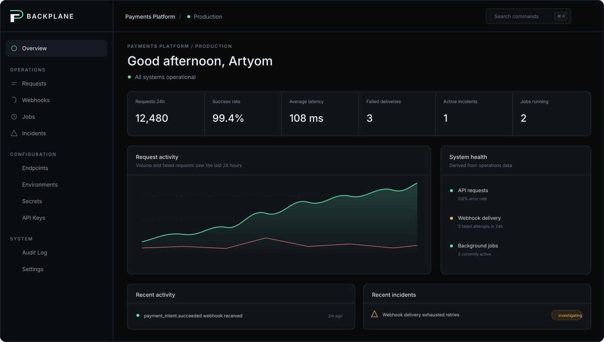
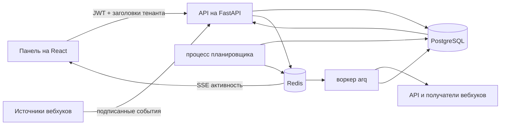

<div align="center">

# BACKPLANE

**Одно место, где видно, что упало, что было повторено и что изменилось в ваших API, вебхуках и фоновых задачах.**

[English](README.md) · [Русский](README.ru.md) · [Қазақша](README.kk.md)


</div>

<p align="center">
  
</p>

## Что это

Сбои интеграций обычно размазаны по логам приложений, панелям очередей, страницам вендоров вебхуков, серверам с cron и личным инструкциям. BACKPLANE собирает этот путь в одну панель управления для команд разработки: вызывать API, принимать и пересылать вебхуки, запускать фоновые и плановые задачи и получать инцидент, когда что-то падает снова и снова.

Он не пытается заменить полноценный стек наблюдаемости. Он нужен в момент, когда надо быстро ответить на три вопроса: что упало, что было повторено и что изменилось.

| Область | Что вы получаете |
|---|---|
| **API** | Реестр исходящих эндпоинтов и консоль запросов с сохранённой историей ответов |
| **Вебхуки** | Публичный приём с проверкой HMAC, повторами, переигровкой и очередью недоставленных |
| **Задачи** | Фоновые задачи на Redis и планировщик cron с учётом часового пояса |
| **Инциденты** | Открываются сами при повторяющихся 5xx, исчерпанных доставках и упавших задачах |
| **Доступ** | Организации, проекты, окружения, четыре роли, ключи API с областями |
| **След** | Журнал аудита, живая лента активности, метрики Prometheus, пробы здоровья |

## Архитектура



Бэкенд это модульный монолит. Каждый доменный модуль владеет своими моделями, схемами, роутерами и бизнес-логикой. Безопасность, ошибки, пагинация, шифрование, логирование и политика исходящих сетевых запросов лежат в нескольких небольших общих модулях. Воркер и планировщик используют те же доменные сервисы и правила базы, что и HTTP-запросы.

## Возможности

| Группа | Подробности |
|---|---|
| **Тенанты и роли** | Организации, проекты, окружения. Роли owner, admin, developer, viewer проверяются на бэкенде |
| **Аутентификация** | JWT, ротация refresh-токенов, хеширование паролей scrypt, ключи API с областями хранятся в виде хешей |
| **Секреты** | Зашифрованное хранилище, зашифрованные учётные данные эндпоинтов, после создания не возвращаются |
| **Консоль API** | Реестр эндпоинтов, консоль запросов из двух панелей, сохранённая история ответов |
| **Приём вебхуков** | Лимит размера, ограничение частоты, проверка HMAC, просмотр событий |
| **Доставка** | Пересылка с паузами 1 / 5 / 15 минут, журнал попыток, переигровка, очередь недоставленных |
| **Задачи** | Очередь Redis, планировщик cron с блокировкой строк PostgreSQL, повторы |
| **Инциденты** | Обнаруживаются автоматически, с жизненным циклом и хронологией |
| **Наблюдаемость** | Структурные логи, ID запросов, метрики Prometheus, SSE, телеметрия из реальных данных |
| **Эксплуатация** | Миграции Alembic, демо-данные, Docker Compose, CI |

## Интерфейс

Интерфейс рассчитан в первую очередь на десктоп, под каждую область есть страница: обзор, консоль запросов, инспектор вебхуков, задачи и расписания, хронология инцидентов, реестр эндпоинтов, окружения, хранилище секретов, ключи API, записи аудита и участники организации. Он адаптивен вплоть до мобильной навигации и сохраняет фокус, состояния загрузки, пустые состояния, ошибки и подтверждения. `Ctrl+K` или `Cmd+K` открывает палитру команд в любом месте.

## Быстрый старт

Нужны Docker с Compose v2 и `make`, либо эквивалентные команды Compose.

```bash
cp .env.example .env
make dev
```

В другом терминале загрузите демо-данные:

```bash
make seed
```

Откройте [http://localhost:8080](http://localhost:8080) и войдите под демо-аккаунтом:

```text
demo@backplane.dev
backplane-demo
```

Документация API в режиме разработки: [http://localhost:8000/docs](http://localhost:8000/docs). `make dev` запускает PostgreSQL, Redis, задачу миграций, API, воркер, планировщик и веб-интерфейс.

## Что нового в этой версии

| Что | Как теперь работает |
|---|---|
| Очередь | Задача попадает в очередь только после коммита транзакции, создавшей её строку, поэтому воркер не находит пустую строку |
| Состояния задач | Задача, которая выбросила исключение, всегда заканчивает в конечном статусе и не зависает в `RUNNING` |
| Повторы | Повторить можно только задачу в статусе `FAILED`. Любое другое состояние даёт `409` |
| Планировщик | После каждой отправки освобождает пул соединений Redis |
| Тесты | 17 тестов, 8 из них про очередь и состояния задач |

## Переменные окружения

| Переменная | Назначение | Значение по умолчанию |
|---|---|---|
| `DATABASE_URL` | Асинхронный DSN PostgreSQL для SQLAlchemy | PostgreSQL из Compose |
| `REDIS_URL` | DSN Redis для очереди, лимитов и активности | Redis из Compose |
| `JWT_SECRET` | Секрет подписи JWT, не короче 32 символов | заменить перед развёртыванием |
| `ENCRYPTION_KEY` | Отдельная парольная фраза для ключа Fernet | заменить перед развёртыванием |
| `CORS_ORIGINS` | JSON-список разрешённых источников браузера | локальные адреса интерфейса |
| `TRUSTED_HOSTS` | JSON-список для middleware хостов | локальные имена сервисов |
| `PUBLIC_API_URL` | Базовый адрес для входящих вебхуков | `http://localhost:8000` |
| `MAX_WEBHOOK_BYTES` | Максимальный размер тела вебхука | 1 MiB |
| `WEBHOOK_RATE_LIMIT` | Событий в минуту на источник и эндпоинт | 120 |
| `ALLOW_PRIVATE_NETWORKS` | Разрешить исходящие запросы на частные и зарезервированные IP | `false` |

Полный список в [.env.example](.env.example). Вне локальной разработки `JWT_SECRET` и `ENCRYPTION_KEY` должны быть независимыми случайными значениями.

## API

Маршруты с авторизацией находятся под `/api/v1`:

```text
/auth                 регистрация, вход, ротация refresh, выход, текущий пользователь
/organizations        настройки организации и участники
/projects             проекты в рамках тенанта
/environments         окружения и несекретные переменные
/endpoints            описания исходящих API
/requests             выполнение запросов и постраничная история
/webhooks             эндпоинты, получатели, входящие, переигровка, повтор
/jobs                 запуски задач и повторы
/scheduled-jobs       расписания cron с часовым поясом
/incidents            обнаружение, жизненный цикл, хронология
/secrets              создать, сменить, список метаданных, удалить
/api-keys             ключ показывается один раз, области, использование, отзыв
/audit                постраничный журнал действий
/activity             последняя активность и поток SSE
/telemetry/dashboard  метрики обзора из базы данных
```

Запросы несут `X-Organization-ID`, `X-Project-ID` и, где нужно, `X-Environment-ID`. Каждый идентификатор сверяется с аутентифицированным субъектом. Ключ API может вызывать только маршруты запросов, вебхуков и задач, которые покрывают его области.

## Безопасность

| Мера | Как |
|---|---|
| Пароли | scrypt со случайной солью для каждого пароля |
| Refresh-токены | Одноразовые: успешное обновление отзывает и заменяет старый токен |
| Секреты | Шифруются перед сохранением и после создания не возвращаются |
| Ключи API | Хранятся только как хеши SHA-256, сам ключ показывается один раз |
| Исходящие запросы | Только HTTP(S), без учётных данных в адресе, без редиректов, частные, loopback, link-local, multicast и зарезервированные адреса по умолчанию заблокированы |
| Вебхуки | Настраиваемый предел размера и ограничение частоты на Redis |
| Ошибки | Единый формат ответа, без трассировок стека |

Это практичная база, а не сертификация. Для публичного развёртывания добавьте TLS, управляемое хранилище секретов или KMS, ограничение частоты на границе, процедуры резервного копирования и восстановления и политику исходящего трафика для вашего окружения.

## Тесты и качество

```bash
make test
make lint
make build
docker compose config --quiet
```

Набор покрывает аутентификацию и повторное использование refresh, изоляцию тенантов между проектами, проверки ролей, подписи вебхуков и инциденты по недоставленным, повторы и состояния задач, публикацию в очередь после коммита, хеширование ключей API и обнаружение инцидентов по повторяющимся 5xx. CI отдельно проверяет сборки Python и TypeScript.

## Структура проекта

```text
backplane/
├── backend/
│   ├── alembic/                 миграции схемы
│   ├── app/
│   │   ├── api/                 зависимости и маршрутизация
│   │   ├── auth/ organizations/ projects/ environments/
│   │   ├── endpoints/ requests/ webhooks/ jobs/ incidents/
│   │   ├── secrets/ api_keys/ audit/ telemetry/
│   │   ├── core/ db/ workers/
│   │   └── main.py
│   └── tests/
├── frontend/
│   └── src/
│       ├── components/          каркас, палитра команд, элементы интерфейса
│       ├── pages/               страницы продукта
│       ├── providers/           состояние авторизации и рабочего пространства
│       └── lib/                 клиент API и форматирование
├── .github/workflows/ci.yml
├── docker-compose.yml
└── Makefile
```

## Планы

- Политики хранения и экспорт
- Настраиваемые пороги для инцидентов
- Связка с трассами OpenTelemetry
- SSO и SAML, доставка приглашений в организацию
- Подключаемые провайдеры KMS для конвертного шифрования
- Ограничения параллелизма и предохранители на уровне получателя

---

<div align="center">

Автор: **[Koncha Artyom](https://github.com/artyom129)** · Лицензия MIT

</div>
